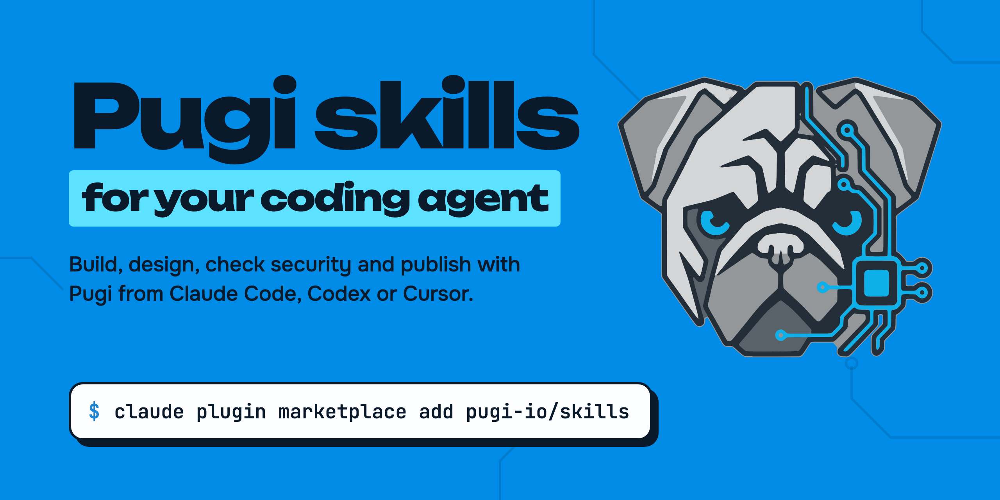

<p align="center">
  <a href="https://pugi.io"></a>
</p>

<p align="center"><strong>Let your coding agent brief Pugi to build, design, secure and publish your app.</strong></p>

<p align="center">
  <a href="https://github.com/pugi-io/skills/releases"></a>
  <a href="LICENSE"></a>
  <a href="#the-skills"></a>
  <a href="#claude-code"></a>
  <a href="#codex"></a>
  <a href="#cursor"></a>
</p>

<p align="center">
  <a href="https://pugi.io">pugi.io</a>&nbsp;&nbsp;|&nbsp;&nbsp;
  <a href="https://docs.pugi.dev/">Docs</a>&nbsp;&nbsp;|&nbsp;&nbsp;
  <a href="https://pugi.io/support">Support</a>&nbsp;&nbsp;|&nbsp;&nbsp;
  <a href="https://pugi.io/pricing">Pricing</a>
</p>

[Pugi](https://pugi.io) is the AI product team that turns a plain brief into a live, tested app. These are Agent Skills for it. Install them in Claude Code, Codex, Cursor or any agent that reads the [Agent Skills](https://agentskills.io/specification) format, and your agent can brief Pugi to build and deliver an app, design it, start from a template, make a brand and a site in it, check and fix security, and publish.

## Install

### Claude Code

```bash
claude plugin marketplace add pugi-io/skills
claude plugin install pugi@pugi
```

Inside a session the same commands are `/plugin marketplace add pugi-io/skills` and `/plugin install pugi@pugi`. The skills then run as `/pugi:<skill>` (for example `/pugi:pugi-publish`), and Claude Code also picks them up on its own when a task matches.

Without the plugin, copy the skill folders into your skills directory:

```bash
git clone https://github.com/pugi-io/skills pugi-skills
mkdir -p ~/.claude/skills
cp -r pugi-skills/skills/* ~/.claude/skills/        # or .claude/skills/ in a project
```

### Codex

```bash
git clone https://github.com/pugi-io/skills pugi-skills
mkdir -p ~/.agents/skills && cp -r pugi-skills/skills/* ~/.agents/skills/
```

Codex reads skills from `.agents/skills/` in the repository (from the working directory up to the repository root) and from `~/.agents/skills/` for your user. To install one skill with the built-in installer:

```text
$skill-installer install https://github.com/pugi-io/skills/tree/main/skills/pugi-publish
```

The repository is also a plugin in the open Agent Plugins format (`plugin.json` at the root, with Codex settings under `extensions.com.openai`), with `.codex-plugin/plugin.json` kept as a fallback and a marketplace file at `.agents/plugins/marketplace.json`:

```bash
codex plugin marketplace add pugi-io/skills
```

Restart Codex so it picks up new skills. Each skill has an `agents/openai.yaml` with its display name and default prompt.

### Cursor

```bash
git clone https://github.com/pugi-io/skills pugi-skills
mkdir -p ~/.cursor/skills && cp -r pugi-skills/skills/* ~/.cursor/skills/
```

Cursor loads Agent Skills from `.cursor/skills/` and `.agents/skills/` in a project, and from `~/.cursor/skills/` and `~/.agents/skills/` for your user. It also reads `.claude/skills/` and `.codex/skills/`.

The repository is also laid out as a single Cursor plugin, following https://github.com/cursor/plugin-template: `.cursor-plugin/plugin.json` at the root with `name`, `description`, `version` and `author`, and the skills in `skills/`. It is not in the Cursor Marketplace yet.

### Any other agent

Each skill is a folder with a `SKILL.md` (YAML front matter plus Markdown) and optional `scripts/`. Copy `skills/<name>/` to wherever your agent loads skills from.

## The skills

| Skill | What it does | Paid plan needed? |
|---|---|---|
| [`pugi-build`](skills/pugi-build/SKILL.md) | Writes a good brief and starts a Pugi build: the quick path from an idea to a project. Uses `pugi build` (CLI) or app.pugi.io | Uses your plan's allowance and credits |
| [`pugi-sdlc`](skills/pugi-sdlc/SKILL.md) | Steers the full delivery run: plan, plan approval, build, tests, security scan, preview approval, going live, with JSON status. Uses `pugi sdlc` (CLI) or app.pugi.io | Uses your plan's allowance and credits |
| [`pugi-artifacts`](skills/pugi-artifacts/SKILL.md) | Gets the project documents (brief, BRD, PRD, user flow, mockups, spec, test plan), then reads, previews and revises them. Uses `pugi artifacts` (CLI) or the Delivery bundle view | Uses your plan's allowance |
| [`pugi-design`](skills/pugi-design/SKILL.md) | Draws or changes the app's design in Design mode and applies it to the code. It can save a Pugi design file for a later Figma import (no public import plugin yet) | Yes, Founder plan or higher to edit. Viewing is on every plan |
| [`pugi-start-from-template`](skills/pugi-start-from-template/SKILL.md) | Starts a project from one of 31 starters at app.pugi.io/templates, or lays a starter down locally with `pugi scaffold` | No, every plan, within the plan's project limit |
| [`pugi-logo`](skills/pugi-logo/SKILL.md) | Gets logo concepts and a brand kit for a business on [logo.pugi.io](https://logo.pugi.io), then wires the kit into the site | No, downloading needs a free sign-in |
| [`pugi-brand-to-site`](skills/pugi-brand-to-site/SKILL.md) | Turns a logo.pugi.io brand into a new website in the same brand | No, every plan. Building uses the plan's allowance |
| [`pugi-security-check`](skills/pugi-security-check/SKILL.md) | Checks a live site or a repo for leaked keys, missing security headers, insecure cookies, public source maps and committed `.env` files, with a bundled script and [pugi.io/security/audit](https://pugi.io/security/audit) | No, the script and the web check are free |
| [`pugi-fix-security`](skills/pugi-fix-security/SKILL.md) | Has Pugi fix the findings ("Let Pugi fix all") and checks again, at app.pugi.io or from pugi.io/security/audit | No, every plan. Free has a daily number of checks |
| [`pugi-deploy-repo`](skills/pugi-deploy-repo/SKILL.md) | Imports an existing GitHub repo (from Lovable, Bolt, v0 or anywhere) and publishes it, through Import from GitHub at app.pugi.io or `git clone` + `pugi publish` | No, import and publishing on a pugi.app address are on every plan |
| [`pugi-publish`](skills/pugi-publish/SKILL.md) | Publishes a folder to a live `*.pugi.app` address with HTTPS, then connects your own domain. Uses `pugi publish` (CLI) or the Publish panel | No for a pugi.app address. Your own domain depends on the plan |

Which one to use: `pugi-build` starts a run; `pugi-sdlc` takes a run through its gates to going live; `pugi-publish` and `pugi-deploy-repo` put code you already have online. Plans and limits: [pugi.io/pricing](https://pugi.io/pricing).

Each skill has a status table that marks every step as **Available**, **Not available today** or **Coming soon**. The skills use only what is live: the `pugi` CLI (`@pugi/cli` 1.0.0-alpha.246 or later, the version the commands were tested against) and pugi.io pages. More agent tools are coming; the skills tell the agent to use them only once they appear in its tool list or in https://pugi.io/llms.txt.

## MCP server

Pugi also runs a remote MCP server for agents. It is listed in the [official MCP Registry](https://registry.modelcontextprotocol.io/v0.1/servers?search=io.pugi/pugi) as `io.pugi/pugi`; its entry is [`server.json`](server.json).

- Address: `https://api.pugi.io/api/agent/v1/mcp` (Streamable HTTP)
- Auth: `Authorization: Bearer pugi_agent_...`. Create a key with `POST https://api.pugi.io/api/agent/v1/keys`.
- Tools: `scan_url` (passive, read-only security check of a public website, graded A+ to F), `get_balance`, `buy_credits_link` (a card checkout link a person opens; it never charges by itself), `publish_status`.

Details, prices and limits: [pugi.io/agents.md](https://pugi.io/agents.md).

## How it keeps you in control

- **Asks before spending.** Every step that builds or spends allowance waits for your yes. The plan Pugi writes is yours to approve, and the build starts only after you approve it.
- **Asks before publishing.** Nothing goes live until you approve the preview or say yes to `pugi publish`.
- **Asks before overwriting.** `pugi scaffold` writes only missing files and lists the ones it skipped. The skill uses `--force`, which overwrites, only when you ask for it.
- **Asks before DNS changes.** Changing DNS moves a domain's traffic, so the skill shows you the current and the new record and waits for your yes. `scripts/check-domain.sh` only reads what DNS and HTTPS say.
- **Runs only when called, where it matters.** In Codex, skills whose main action can spend credits, publish or change a project set `allow_implicit_invocation: false`, so they run only when you call them, for example `$pugi-publish`. Only `pugi-security-check` and `pugi-logo` may start on their own.
- **Never prints secrets.** `pugi publish` prints only the names of env keys, and `pugi-security-check` reports the file and the type of a key, never its value.

## Requirements

- For the CLI skills (`pugi-build`, `pugi-sdlc`, `pugi-artifacts`, `pugi-publish`, `pugi-deploy-repo`): Node.js 18+, git, and a Pugi account. Install the CLI with `npm i -g @pugi/cli` and sign in with `pugi login`. The sign-in is a device flow: you approve it in your browser.
- For `pugi-security-check`: Python 3.8+ and git. The script uploads nothing; the optional MCP tool `scan_url` sends the URL to Pugi.
- For the console skills (`pugi-design`, `pugi-start-from-template`, `pugi-brand-to-site`, `pugi-fix-security`, `pugi-logo`): a browser. `pugi-design` needs the Founder plan or higher.

## Repository layout

```text
.
├── .claude-plugin/
│   ├── plugin.json          Claude Code plugin manifest
│   └── marketplace.json     Claude Code marketplace (one plugin: this repo)
├── plugin.json              Agent Plugins manifest (Codex reads extensions.com.openai)
├── .codex-plugin/plugin.json  Codex fallback manifest
├── .agents/plugins/marketplace.json
├── .cursor-plugin/plugin.json
├── server.json              MCP Registry entry for the Pugi MCP server (io.pugi/pugi)
├── smithery/                Smithery listing text and config schema
├── assets/                  icon, banner, social preview, NOTICE
├── skills/                  one folder per skill: SKILL.md, agents/openai.yaml, optional scripts/
│   ├── pugi-build/  pugi-sdlc/  pugi-artifacts/  pugi-design/
│   ├── pugi-start-from-template/  pugi-logo/  pugi-brand-to-site/
│   ├── pugi-security-check/     scripts/precheck.py
│   ├── pugi-fix-security/  pugi-deploy-repo/
│   └── pugi-publish/            scripts/check-domain.sh
└── scripts/check.sh         Validates front matter and scans this repo for secrets
```

The skills format is the same for every agent: one `SKILL.md` per folder. Only the plugin manifests differ, so each agent gets its own manifest next to the shared `skills/` folder.

<details>
<summary>Formats this repository follows</summary>

- Agent Skills specification: https://agentskills.io/specification
- Claude Code plugins, manifest reference: https://code.claude.com/docs/en/plugins/manifest-reference
- Claude Code plugin marketplaces: https://code.claude.com/docs/en/plugin-marketplaces and https://code.claude.com/docs/en/plugins/marketplace-reference
- Codex skills: https://learn.chatgpt.com/docs/build-skills
- Codex plugins and marketplaces, and the portable root plugin.json: https://developers.openai.com/plugins/build/plugins
- Cursor skills: https://cursor.com/docs/skills
- Cursor plugins: https://cursor.com/docs/plugins and the single-plugin layout in https://github.com/cursor/plugin-template

</details>

## Contributing

Bug reports and skill requests are welcome in [Issues](https://github.com/pugi-io/skills/issues). Before a pull request, run `bash scripts/check.sh`. See [CONTRIBUTING.md](CONTRIBUTING.md).

## Security

Report a vulnerability to security@pugi.io, not in a public issue. See [SECURITY.md](SECURITY.md).

## Support

Questions about your account, plan or a build: [pugi.io/support](https://pugi.io/support) or support@pugi.io. Developer docs: [docs.pugi.dev](https://docs.pugi.dev/).

## License

The skills, scripts and documentation are under the MIT License. See [LICENSE](LICENSE). Each skill folder carries its own copy as `LICENSE.txt`, so a skill copied on its own keeps the notice.

The images in `assets/` (`icon.png`, `banner.png` and `social-preview.png`) show the Pugi logo and are not under the MIT License. They are included only so that plugin directories and this page can show Pugi's mark, and you may redistribute them unchanged as part of this repository for that purpose. "Pugi" and the Pugi logo are trademarks of Pugi Inc.; the license gives no right to use them otherwise. See [assets/NOTICE](assets/NOTICE).
